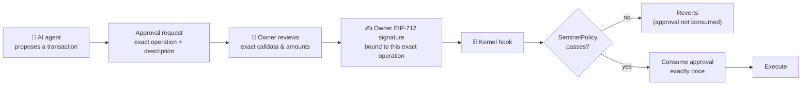
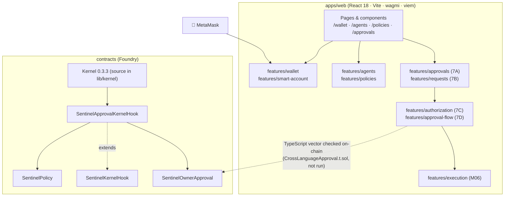
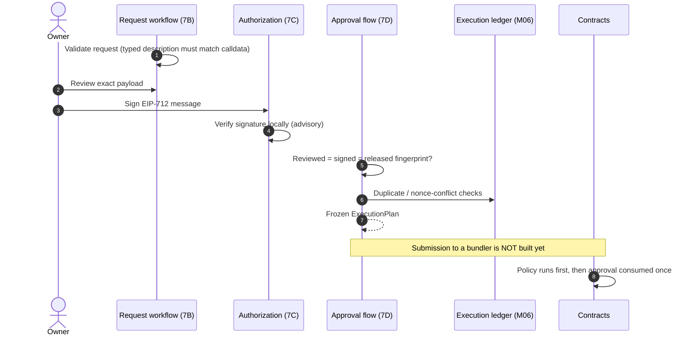

<div align="center">

# 🛡️ Sentinel Wallet

### Agent Wallet: letting AI agents pay safely

*The agent proposes. The smart account and on-chain policy decide.*


-blue)


</div>

---

## ⚠️ Read this first

- **Test networks and test funds only.** Nothing here has been security-audited.
- **The Solidity has not been compiled or run by the author.** `forge build && forge test -vv` is the first step.
- **The UI does not sign or submit anything yet.** `/approvals` uses labelled demo data; its Approve/Reject buttons are local decisions, not signatures.
- **Module 06 (execution) is not accepted.** No UserOperation has executed on a local chain, and no bundler client exists.
- Policies and agent records live in **browser `localStorage`**. There is no backend, database or AI component yet.

---

## 📖 Overview

Sentinel Wallet is a security-first wallet design for AI agents. An agent may *propose* a transaction, but it can only execute if the owner's smart account and on-chain policy allow it. The project is built in 12 modules; this delivery covers Modules 01–05, a partial Module 06, and Modules 7A–7D.



---

## 🧩 Module status

| Module | Scope | State |
|--------|-------|-------|
| 01 | Design system (strict monochrome), app shell, env parsing | Delivered |
| 02 | MetaMask connect, network switching (Sepolia, Anvil) | Delivered |
| 03 | Read-only smart-account overview (EntryPoint v0.7) | Delivered |
| 04 | Agent registry (browser-local) | Delivered, **not enforced on-chain** |
| 05 | Spending-policy drafts and preview; `SentinelPolicy.sol` added | Front end delivered; contract **unverified**, not wired to the app |
| 06 | Transaction validation & execution | **Partial, not accepted** (domain layer only) |
| 7A | Owner approval review UI | Demo data only |
| 7B | Approval request schema, validation, lifecycle | Domain logic only, no UI |
| 7C | Owner authorization contracts + TypeScript signing/verification | Contracts **unverified** |
| 7D | Integration of 7B + 7C + Module 06 ledger | **Partial, not accepted**; UI not wired |
| 08–12 | Not started | — |

> Real Vitest and production-build runs are still unconfirmed by the author of the latest delivery; see `MODULE_HANDOVER.md` for the exact test status.

---

## 🏗️ Architecture



The client-side layer is **advisory**; the contracts are authoritative.

---

## 🔐 Approval flow (7B → 7C → 7D)



**Properties enforced in the domain logic and contracts**

| Guarantee | Where |
|-----------|-------|
| Decision is bound to the exact reviewed payload; any change makes the request pending again | 7A / 7B |
| `approved` status alone never authorizes execution | 7B `evaluateRelease` |
| Signature binds account, agent, `operationId`, `userOpNonce`, `executionHash`, expiry | 7C |
| Signature is single-use; `operationId` never reusable; lifetime ≤ 7 days | `SentinelOwnerApproval` |
| Prohibited operations stay prohibited even with a valid approval | `SentinelApprovalKernelHook` (policy first) |
| "Confirmed" only on receipt + `UserOperationEvent` | Module 06 / 7D |

---

## ✨ What works today (browser)

| Page | Route | Description |
|------|-------|-------------|
| Wallet | `/wallet` | MetaMask connect, network status, read-only smart-account and EntryPoint info |
| Agents | `/agents` | Register, pause, resume, revoke agents (local only) |
| Policies | `/policies` | Per-agent limits and allowlists, with a preview evaluator (drafts only) |
| Approvals | `/approvals` | Queue and review dialog using **demo data** |
| Others | `/dashboard`, `/ai-agent`, `/transactions`, `/analytics`, `/security`, `/settings` | Placeholders that state which module delivers them |
| Design system | `/design-system` | Component reference |

### Policy semantics (deny by default)

- Empty allowlist allows nothing of that kind.
- Limits apply to **native value only**; token amounts are not limited.
- Daily window is the UTC calendar day; "already spent today" is typed by hand because spending is not tracked yet.
- Paused, expired or revoked agents are denied everything; malformed stored limits fail closed.

---

## 🚀 Getting started

**Requirements:** Node.js **≥ 20.11** (22 LTS recommended), npm 10+, Git (optional). Foundry for contracts.

```powershell
cd apps\web
npm install
Copy-Item .env.example .env.local
npm run dev
```

Open <http://localhost:5173>. If PowerShell blocks npm:

```powershell
Set-ExecutionPolicy -Scope CurrentUser -ExecutionPolicy RemoteSigned
```

### Contracts

```powershell
cd contracts
forge install eth-infinitism/account-abstraction@v0.7.0   # plus solady and forge-std if absent
forge build; forge test -vv
```

### Commands (run from `apps\web`, or from the root where they delegate)

| Command | Purpose |
|---------|---------|
| `npm run dev` | Dev server on port 5173 |
| `npm run build` | Type-check, then build to `dist/` |
| `npm run preview` | Serve the production build on 4173 |
| `npm run typecheck` | Strict TypeScript check |
| `npm run lint` | ESLint (TypeScript, React hooks, jsx-a11y) |
| `npm run format` / `format:check` | Prettier |
| `npm test` | Vitest, run once |
| `npm run check` | typecheck, lint, format check, tests and build in sequence |

### Environment variables (`apps/web/.env.example`)

Only `VITE_`-prefixed variables reach the browser; **never put secrets in them.**

| Variable | Default | Meaning |
|----------|---------|---------|
| `VITE_APP_NAME` | Sentinel Wallet | Display name |
| `VITE_DEFAULT_CHAIN_ID` | 11155111 | Sepolia (11155111) or Anvil (31337); other values fail at startup |
| `VITE_EXPLORER_URL` | https://sepolia.etherscan.io | Explorer base URL (used from Module 09) |
| `VITE_API_BASE_URL` | http://localhost:4000 | Backend URL (reserved, not built) |
| `VITE_SMART_ACCOUNT_ADDRESS_SEPOLIA` | empty | Smart-account address on Sepolia (optional) |
| `VITE_SMART_ACCOUNT_ADDRESS_ANVIL` | empty | Smart-account address on Anvil (optional) |

### Ports

| Service | Port | Status |
|---------|------|--------|
| Vite dev | 5173 | In use |
| Vite preview | 4173 | In use |
| Backend API | 4000 | Reserved, not built |

---

## 📁 Project structure

```text
Agentwallet/
├── package.json                 root scripts delegate to apps/web
├── MODULE_HANDOVER.md           features, test results and limitations per delivery
├── apps/web/
│   ├── src/
│   │   ├── components/ui/       Button, Card, Dialog, Field, Notice, Table, Toast ...
│   │   ├── components/layout/   AppShell, SidebarNav, PageHeader, BrandMark
│   │   ├── features/
│   │   │   ├── wallet/          chains, error classification, wagmi config, useWallet
│   │   │   ├── smart-account/   EntryPoint v0.7, deployment-state derivation, chain reads
│   │   │   ├── agents/          rules, local storage, registry UI
│   │   │   ├── policies/        draft validation, evaluator, editor and preview
│   │   │   ├── execution/       Module 06 domain layer (no UI)
│   │   │   ├── approvals/       7A demo requests, calldata description, review UI
│   │   │   ├── requests/        7B schema, lifecycle, registry, release gate
│   │   │   ├── authorization/   7C typed data, signing, verification
│   │   │   └── approval-flow/   7D integration logic
│   │   ├── config/  pages/  test/
│   └── tailwind.config.ts       monochrome tokens
├── contracts/
│   ├── src/                     SentinelPolicy, SentinelKernelHook,
│   │                            SentinelOwnerApproval, SentinelApprovalKernelHook
│   ├── test/                    Foundry tests
│   ├── scripts/check-chain.ps1  read-only chain check (needs Foundry)
│   └── lib/kernel               Kernel 0.3.3 source
└── docs/                        ARCHITECTURE, SMART_ACCOUNT, POLICY_CONTRACT,
                                 EXECUTION_MODEL, REQUEST_WORKFLOW, APPROVAL_UI,
                                 OWNER_AUTHORIZATION, APPROVAL_FLOW
```

---

## 🧪 Verification status

| Check | Result (per `MODULE_HANDOVER.md`) |
|-------|-----------------------------------|
| 7D `flow.test.ts` (29 tests) | Passed under a throwaway shim, **not** real Vitest/viem |
| 7C authorization tests (37) | Passed under the same shim |
| Pure-logic regression (380 tests) | Passed under the shim |
| Strict `tsc` on new 7D files | Passed with type-stubbed viem/vitest |
| 69 earlier Foundry tests | Owner-reported passing; not re-run after later additions |
| 43 Foundry tests (7C), 11 cross-language tests (7D), 18 Kernel integration tests | **Not run** |
| Real Vitest, `typecheck`, `lint`, `format:check`, `build` | **Not run** |
| Browser / MetaMask `eth_signTypedData_v4` | **Not run** (no UI signs yet) |

---

## 🚧 Known limitations and blockers

1. Run `forge build && forge test -vv` and fix whatever fails.
2. Install Kernel dependencies (solady, EntryPoint v0.7, forge-std) and get `KernelUserOp.t.sol` green to meet the Module 06 gate.
3. Wire the UI to the flow with real RPC reads, wallet signing and an `OperationSender` (needs deployed local addresses and a bundler).
4. Write a Kernel + EntryPoint + approval-hook end-to-end test on Anvil.
5. Agent status and spending policy are **not enforced on-chain** from the app yet; the web app is not connected to `SentinelPolicy`.
6. EOA owner only; the signer must equal `POLICY.owner()` and the Kernel root owner (not enforced).
7. No persistence for the execution ledger and no reorg handling; batch executions are not built in TypeScript.
8. `CURRENT_MODULE` in `navigation.ts` is still `5`, and `forge lint` warnings from earlier modules are unresolved.

---

## 🛠️ Troubleshooting

| Problem | Fix |
|---------|-----|
| Port 5173 in use | Close the other process or change `server.port` in `vite.config.ts` |
| `npm install` fails behind a proxy | `npm config set proxy` and `https-proxy` |
| Blank page | Check the browser console; an invalid `.env.local` value throws at startup |
| Git line-ending warnings on Windows | Harmless; Prettier is set to LF |
| MetaMask still lists the site after Disconnect | Remove it under MetaMask's connected-sites settings |

---

## 🎨 Design rules enforced in code

- Strict monochrome: `monochrome.test.ts` fails if a non-gray color, gradient, shadow or blur appears.
- Every control works or is disabled with a reason (tooltip plus screen-reader text).
- Visible focus outlines, skip link, labelled dialogs with focus trap, polite notifications.

---

## 📸 Screenshots

Add images after running the app, e.g. under `docs/screenshots/`:

| Wallet | Agents | Policies | Approvals |
|:--:|:--:|:--:|:--:|
| _add image_ | _add image_ | _add image_ | _add image_ |

---

<div align="center">

Never place private keys, seed phrases or API secrets in any committed file.

</div>
